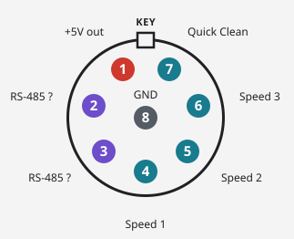

# Pool manager

[Waveshare ESP32-S3](https://a.co/d/0ga62LVe) that controls the pump and measures the salt cell.

## Pump connector



_Pump receptacle (looking at male pins)_

| Pin | Function                            | Factory 356324Z wire | Candice wire | Waveshare            |
|-----|-------------------------------------|----------------------|--------------|----------------------|
| 1   | +5 V output (for triggering inputs) | Red                  | Red          | Ch 1, 2, 3, 4 common |
| 2   | RS-485 (A or B)                     | Yellow or green      | Blue         | RS-485 A+            |
| 3   | RS-485 (B or A)                     | Green or yellow      | White        | RS-485 B-            |
| 4   | Speed 1 digital input               | White                | Green        | Ch 4 NO              |
| 5   | Speed 2 digital input               | Blue                 | Brown        | Ch 3 NO              |
| 6   | Speed 3 digital input               | Orange               | Orange       | Ch 2 NO              |
| 7   | Quick Clean digital input           | Brown                | Yellow       | Ch 1 NO              |
| 8   | Common ground                       | Black                | Black        | RS-485 ground        |

5V output limited to 0-20 mA.

RS-485 A (+, yellow) and B (-, green) may be switched.  Common ground connects to RS-485 module's GND.  Must set pump into External Control mode from keypad.

Each digital input accepts 0 or 5–30 V AC/DC. Feed it from pin 1 through a relay contact, or from an external supply with pin 8 as the return. If more than one is on, the order is Quick Clean > Speed 3 > Speed 2 > Speed 1.

## Salt cell

```
Cell plug, looking at the contacts
(cord hanging down)
   ┌─────┬─────┐
   │  1  │  2  │  power
   │  3  │  4  │  power
   │  5  │  6  │  unused / thermistor
   │  7  │  8  │  OEM cell sense
   │  9  │ 10  │  unused / thermistor
   └─────┴─────┘
         ↓ cord
```

| Pin | OEM    | Breakout    | Control side   | Cell side            |
|-----|--------|-------------|----------------|----------------------|
| 1   | Black  | Right-red   | INA228 U1 VIN+ | INA228 U1 VIN-, VBUS |
| 2   | White  | Left-brown  | INA228 U3 VIN+ | INA228 U3 VIN-, VBUS |
| 3   | Black  | Right-green | INA228 U2 VIN+ | INA228 U2 VIN-, VBUS |
| 4   | White  | Left-blue   | INA228 U4 VIN+ | INA228 U4 VIN-, VBUS |
| 5   | Brown  | Right-white |
| 6   | Red    | Left-white  |
| 7   | Orange | Right-blue  |
| 8   | Yellow | Left-green  |
| 9   | Green  | Right-brown |
| 10  | Blue   | Left-red    | INA228 ground  |

| Chip | Address | A1      | A0      |
|------|---------|---------|---------|
| U1   | 0x40    | Open    | Open    |
| U2   | 0x41    | Open    | Bridged |
| U3   | 0x44    | Bridged | Open    |
| U4   | 0x45    | Bridged | Bridged |

ESP32 connects to INA228s via I2C and power isolator.  Leave the INA228 VBUS jumper open; the Left‑red tap must be the only ground connection on the isolated side, and nothing else on that side may touch earth.
